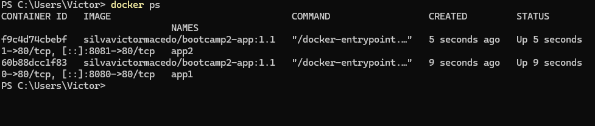

Explorador de Países — agora com lista "quero visitar" e Docker
Autor
Victor Silva Macedo — Matrícula 22510294
Descrição
Aplicação web que busca países pelo nome (dataset aberto mledoze/countries, servido via jsDelivr, e bandeiras do flagcdn.com) e permite salvar uma lista "quero visitar" que persiste em banco de dados real (Supabase/PostgreSQL). Distribuída via GitHub Pages e como imagem Docker no Docker Hub.
Links
Repositório GitHub: https://github.com/silvavictormacedo/bootcamp2-app
Aplicação (GitHub Pages): https://silvavictormacedo.github.io/bootcamp2-app/
Imagem no Docker Hub: https://hub.docker.com/r/silvavictormacedo/bootcamp2-app
Como executar
Com Docker (um comando)
```
docker run -d -p 8080:80 silvavictormacedo/bootcamp2-app:1.1
```
Depois abra http://localhost:8080 (tags disponíveis: `1.0`, `1.1`, `latest`).
No navegador
Acesse o link do GitHub Pages acima.
Localmente a partir do código
`git clone https://github.com/silvavictormacedo/bootcamp2-app.git` e depois `docker compose up --build` (ou abra `index.html`).
Persistência de dados
Banco: Supabase (PostgreSQL), região South America (São Paulo).
Tabela `favoritos`: `id` (bigint, identidade, PK), `criado_em` (timestamptz, default now()), `codigo` (text, unique, ex.: BRA), `nome` (text), `bandeira` (text).
O que é salvo: países que o usuário quer visitar (código, nome e URL da bandeira), para a lista abrir sem reconsultar a API.
Operações: criar (✈️ Quero visitar), listar (carrega ao abrir a página) e excluir (✖). País duplicado e falhas do banco geram mensagem amigável.
Segurança / limitação conhecida: RLS ativo, com políticas de select, insert e delete abertas para `anon`. Como não há login, todos os visitantes veem e alteram a mesma lista. Apenas a URL e a anon key (públicas por design) estão no código; a `service_role` nunca foi usada. O script SQL está em `supabase.sql`.
Evidências das sidequests
SQ1 · .dockerignore
O arquivo `.dockerignore` exclui `.git`, `README.md`, `docs`, `supabase.sql` e arquivos de build. Como o `COPY . /usr/share/nginx/html` copia a pasta inteira, sem o `.dockerignore` o histórico do Git e outros arquivos sem uso no servidor entrariam na imagem. Excluí-los deixa a imagem menor e o build mais rápido, porque o Docker envia menos arquivos como contexto de build, além de evitar publicar conteúdo que não pertence à aplicação.
SQ2 · Versionamento de imagem
Publicadas as tags `1.0` (primeira versão funcional), `1.1` (rodapé exibe a versão e o título da lista mostra o total de países salvos) e `latest`. Conferir em https://hub.docker.com/r/silvavictormacedo/bootcamp2-app/tags
SQ3 · Descrição no Docker Hub
O Overview do repositório contém: o que é a aplicação, o comando `docker run` pronto e o link do repositório GitHub.
SQ4 · Explorando a orquestração
Dois containers da mesma imagem rodando ao mesmo tempo, nas portas 8080 e 8081:
```
docker run -d -p 8080:80 --name app1 silvavictormacedo/bootcamp2-app:1.1
docker run -d -p 8081:80 --name app2 silvavictormacedo/bootcamp2-app:1.1
docker ps
```

"Se eu tivesse 100 containers, como gerenciaria?" Subir, vigiar e reiniciar 100 containers à mão com `docker run` seria inviável. É para isso que existe o Kubernetes, um orquestrador. Ele organiza as máquinas num cluster (conjunto de servidores gerenciados como um só). A menor unidade que ele executa é o pod, que embrulha um ou mais containers. Eu declaro o estado desejado, por exemplo "quero 100 réplicas desta imagem", e o Kubernetes cria os pods, distribui entre as máquinas, substitui os que caem e permite aumentar ou reduzir o número de réplicas com um comando, além de atualizar versões sem derrubar o serviço.
